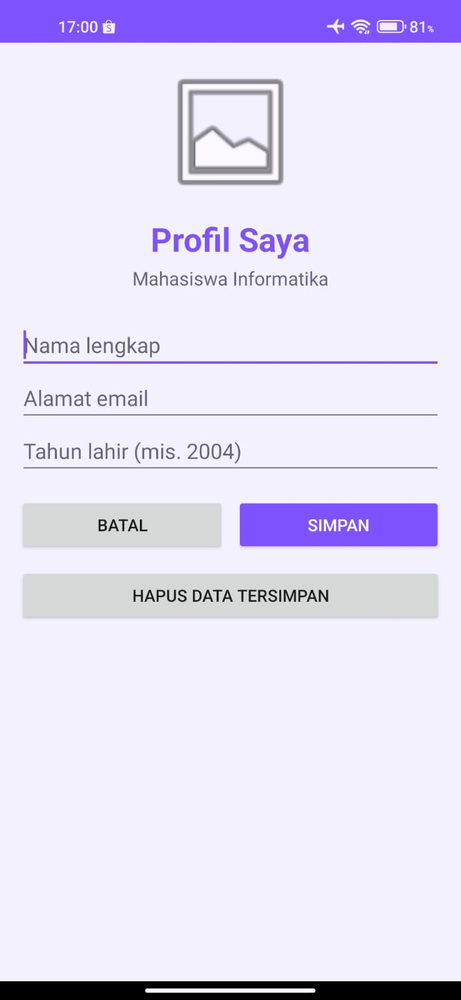
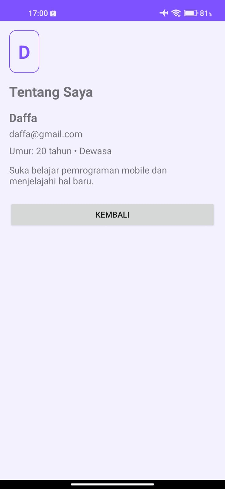
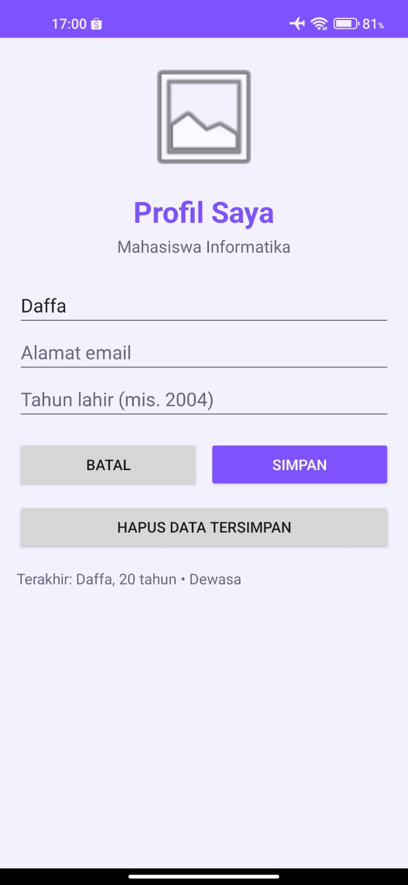
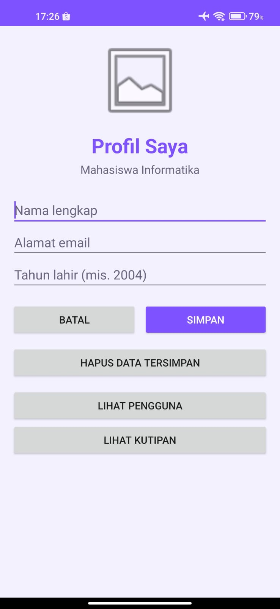
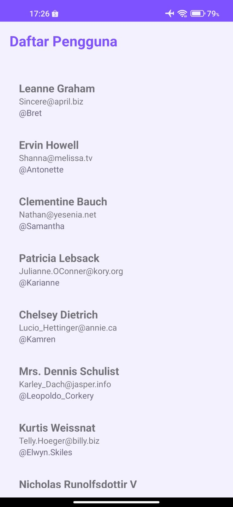
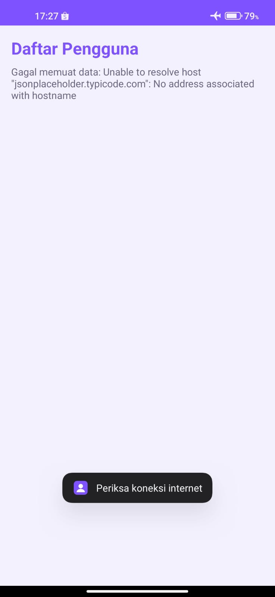

# Proyek Kartu Profil — Project Utuh Pertemuan 9 & 10

Project Android **lengkap dan berdiri sendiri**: aplikasi **Kartu Profil**
versi akhir **Pertemuan 9 — Penyimpanan Data Lokal: SharedPreferences
dan Room Dasar**. Project ini adalah kelanjutan langsung dari project
utuh Pertemuan 7 dengan versi build yang sama persis (sudah terbukti
jalan) — tidak ada upgrade stack.

Yang baru di Pertemuan 9 (modul Bagian 5–8):

- **Menyimpan dengan SharedPreferences** — setelah validasi lolos dan
  **sebelum** `startActivity`, nama, umur, dan kategori terakhir
  disimpan ke berkas `"profil"` (`MODE_PRIVATE`) dengan kunci
  `nama_terakhir`, `umur_terakhir`, `kategori_terakhir`. Kunci ditulis
  sebagai konstanta di `companion object` (`PREFS_PROFIL`,
  `KEY_NAMA_TERAKHIR`, `KEY_UMUR_TERAKHIR`, `KEY_KATEGORI_TERAKHIR`)
  supaya simpan dan baca tidak pernah salah eja. Menyimpan memakai
  `apply()`, bukan `commit()`.
- **Membaca kembali saat aplikasi dibuka** — di `onCreate`, setelah
  `findViewById`, nama terakhir dibaca dengan
  `prefs.getString(KEY_NAMA_TERAKHIR, "") ?: ""` dan diisi otomatis ke
  kolom nama; bila umur dan kategori juga tersimpan, `tvStatus`
  menampilkan `"Terakhir: Budi, 22 tahun • Dewasa"`. Bila belum ada data
  tersimpan, kolom tetap kosong seperti semula.
- **Tombol "Hapus data tersimpan"** (`btnHapusSimpan`, di bawah tombol
  Simpan/Batal) — menghapus semua kunci di berkas `"profil"` dengan
  `prefs.edit().clear().apply()`, mengosongkan kolom nama, dan
  menampilkan `"Data tersimpan dihapus."`.
- **Penyimpanan yang dipilih: SharedPreferences saja.** Room tidak
  dipakai di project ini. Alasan dan perbandingannya ada di bagian
  "SharedPreferences atau Room?" di bawah.

Yang tetap dari Pertemuan 7: kolom Nama, Email, dan Tahun Lahir;
validasi berlapis (kosong, format email, angka, rentang tahun);
perhitungan umur dan kategori dengan `when` (Anak 0–12, Remaja 13–17,
Dewasa 18–59, Lansia 60+); hasil olahan dikirim lewat Intent ke layar
kedua beserta lencana inisial.

Package: `com.example.belajarmobile` • Min SDK 24 • Target/Compile SDK 34
Gradle 8.7 • Android Gradle Plugin 8.5.2 • Kotlin 2.0.20 • AppCompat 1.7.0
Retrofit 2.9.0 • converter-gson 2.9.0 • RecyclerView 1.3.2 (Pertemuan 10)
Coroutines 1.8.1 • lifecycle-runtime-ktx 2.8.7 (Pertemuan 11)

## Cara menjalankan

Sama persis seperti project Pertemuan 4–7:

1. Ekstrak ZIP, buka folder `proyek-kartu-profil-p9` di VS Code (folder
   yang berisi `gradlew.bat`).
2. Hubungkan HP (USB debugging atau adb wireless), cek `adb devices`
   statusnya `device`.
3. Dari terminal PowerShell:

   ```powershell
   .\gradlew installDebug
   ```
4. Bila muncul "SDK location not found", buat `local.properties` di folder
   akar project berisi `sdk.dir=<path SDK di komputer itu>` (contoh:
   `sdk.dir=C\:\\Users\\NamaKamu\\AppData\\Local\\Android\\Sdk`).

Build pertama mengunduh Gradle 8.7 + dependency — perlu internet.

## Alur uji

**Kasus utama — aplikasi mengingat:**

1. Isi nama, email yang benar, tahun lahir mis. 2004 → tekan **Simpan**
   → pindah ke layar kedua seperti biasa.
2. Tutup aplikasi **sepenuhnya** (dari daftar aplikasi terakhir, bukan
   sekadar tekan Home), lalu buka lagi → kolom nama **terisi otomatis**
   dengan nama terakhir, dan `tvStatus` menampilkan
   `"Terakhir: <nama>, 22 tahun • Dewasa"` (sesuai tahun berjalan).
3. Bukti paling kuat datanya tersimpan lokal: buka **Pengaturan HP →
   Aplikasi → Kartu Profil → Penyimpanan → Hapus data**, lalu buka lagi
   aplikasi → kolom nama kosong lagi.

**Tombol hapus:** tekan **Hapus data tersimpan** → kolom nama kosong dan
`tvStatus` menampilkan `"Data tersimpan dihapus."` → tutup aplikasi,
buka lagi → kolom nama tetap kosong.

**Kasus valid & tidak valid (tetap seperti Pertemuan 7):** nama
dikosongkan → error, tidak pindah layar dan **tidak ada data baru yang
tersimpan** (data hanya disimpan setelah validasi lolos); email tanpa "@"
→ error format; tahun lahir huruf / 2030 → error; **Batal**
mengosongkan ketiga kolom sekaligus menghilangkan tanda error.

**Tangkapan Layar**

Disini sebagai contoh jika kita sudah pernah menginput data sebelumnya maka pada saat kita login ke aplikasi ulang maka hasilnya akan tersimpan, berikut untuk hasilnya



**Gambar 1: Tampilan awal.** Aplikasi baru dibuka dan belum ada data tersimpan. Kolom nama, email, dan tahun lahir kosong, dengan tombol Batal, Simpan, dan Hapus data tersimpan.


**Gambar 2: Input data.** Formulir diisi: nama `Daffa`, email `daffa@gmail.com`, tahun lahir `2006`. Lalu tekan **Simpan**.



**Gambar 3: Data tersimpan.** Setelah validasi lolos, data disimpan lalu aplikasi pindah ke layar "Tentang Saya": nama, email, dan hasil olahan `Umur: 20 tahun • Dewasa`.



**Gambar 4: Dibuka ulang.** Aplikasi ditutup lalu dibuka lagi. Kolom nama terisi otomatis `Daffa` dan status menampilkan `Terakhir: Daffa, 20 tahun • Dewasa`, dibaca dari SharedPreferences. Email dan tahun lahir kosong karena yang disimpan hanya nama, umur, dan kategori.

## SharedPreferences atau Room?

Project ini memakai **SharedPreferences**. Perbandingannya:

|                       | SharedPreferences                                           | Room                                             |
| --------------------- | ----------------------------------------------------------- | ------------------------------------------------ |
| Bentuk data           | Pasangan kunci-nilai: satu atau dua nilai                   | Tabel: banyak baris terstruktur                  |
| Contoh di project ini | `nama_terakhir`, `umur_terakhir`, `kategori_terakhir` | Tabel `catatan` (di proyek latihan terpisah)   |
| Menyimpan lagi        | Menimpa nilai kunci yang sama, tidak ada riwayat            | Menambah baris baru, riwayat tetap ada           |
| Mencari / mengurutkan | Tidak bisa                                                  | Bisa, lewat query SQL (`WHERE`, `ORDER BY`)  |
| Kode yang dibutuhkan  | Beberapa baris: `edit().putString(...).apply()`           | Entity, Dao, Database, plus library Room dan KSP |
| Dipanggil dari        | Langsung di `MainActivity`                                | Dari coroutine (dipelajari di Pertemuan 11)      |
| Biaya belajar         | Rendah                                                      | Lebih tinggi                                     |

**Kenapa SharedPreferences cocok untuk Kartu Profil ini:** aplikasi hanya
mengingat satu profil terakhir, yaitu tiga nilai yang saling menimpa.
Tidak ada daftar yang bertambah dan tidak ada kebutuhan mencari atau
mengurutkan, jadi tabel database tidak memberi keuntungan.

**Kapan sebaiknya pindah ke Room:** bila aplikasi harus menyimpan banyak
profil atau riwayat (misalnya daftar semua profil yang pernah diisi) dan
perlu menampilkannya terurut atau mencarinya. Memaksa daftar seperti itu
masuk ke SharedPreferences dengan menggabungkan teks secara manual adalah
tanda datanya sudah layak masuk Room.

## Pertemuan 10: Mengambil Data dari Internet (REST API)

> Bagian ini menggambarkan versi Pertemuan 10 (callback `enqueue`). Sejak
> Pertemuan 11 pemuatan data memakai coroutine, dan teks status serta pesan
> gagalnya berubah. Lihat bagian Pertemuan 11 di bawah.

Kartu Profil kini punya dua tombol baru di layar utama. Data profil tetap
disimpan **lokal** (SharedPreferences, Pertemuan 9), sedangkan dua daftar
baru ini **diambil dari server lewat internet** setiap kali layarnya dibuka.

| Tombol                                          | Layar                             | Sumber data                                                                    |
| ----------------------------------------------- | --------------------------------- | ------------------------------------------------------------------------------ |
| **Lihat Pengguna** (`btnLihatPengguna`) | `UserListActivity`: 10 pengguna | JSONPlaceholder, `GET https://jsonplaceholder.typicode.com/users`            |
| **Lihat Kutipan** (`btnLihatKutipan`)   | `QuoteListActivity`: 10 kutipan | DummyJSON, `GET https://dummyjson.com/quotes?limit=10` (API pilihan sendiri) |

### Cara kerjanya

Aplikasi meminta data ke server lewat URL dengan method `GET`. Server
menjawab JSON, Gson mengubahnya menjadi objek Kotlin, lalu `RecyclerView`
menampilkannya sebagai daftar yang bisa digulir. Pemanggilan memakai
`enqueue` (callback), **bukan coroutine** (coroutine baru di Pertemuan 11).

| Berkas                                            | Peran                                                                                         |
| ------------------------------------------------- | --------------------------------------------------------------------------------------------- |
| `User.kt`, `Quote.kt`                         | Model: satu objek JSON = satu `data class`. Nama field harus sama persis dengan kunci JSON. |
| `ApiService.kt`                                 | Interface endpoint (`@GET("users")`, `@GET("quotes?limit=10")`), tanpa `suspend`.       |
| `RetrofitClient.kt`                             | `object` + `by lazy`: Retrofit dibangun sekali, alamat dasar wajib diakhiri `/`.        |
| `UserAdapter.kt`, `QuoteAdapter.kt`           | Penghubung data dengan baris `item_user.xml` / `item_quote.xml`.                          |
| `UserListActivity.kt`, `QuoteListActivity.kt` | Memanggil API dengan `enqueue` dan mengatur tiga keadaan layar.                             |

Tiga keadaan yang ditangani di kedua layar:

| Keadaan                           | Tampilan                                                                                    |
| --------------------------------- | ------------------------------------------------------------------------------------------- |
| Memuat                            | `ProgressBar` berputar, teks "Memuat ..."                                                 |
| Sukses (`onResponse`, kode 2xx) | `ProgressBar` hilang, daftar tampil                                                       |
| Gagal (`onFailure`)             | `ProgressBar` hilang, pesan "Gagal memuat data: ..." dan Toast "Periksa koneksi internet" |

Jika server menjawab tetapi bukan 2xx (misalnya 404), jawaban itu tetap
masuk `onResponse`, bukan `onFailure`. Aplikasi menampilkan
"Server menjawab dengan kode ..." supaya `ProgressBar` tidak berputar terus.

### Data lokal dan data internet

|                          | Lokal (SharedPreferences)     | Internet (REST API)                 |
| ------------------------ | ----------------------------- | ----------------------------------- |
| Asal data                | Disimpan di HP sendiri        | Diminta ke server                   |
| Tanpa internet           | Tetap ada                     | Gagal diambil (Toast + pesan error) |
| Tutup lalu buka aplikasi | Data tetap tersimpan          | Diambil ulang dari server           |
| Contoh di project ini    | Nama, umur, kategori terakhir | Daftar pengguna dan kutipan         |

Keduanya saling melengkapi: Kartu Profil memakai penyimpanan lokal, dua
daftar baru memakai data dari internet.

**Tangkapan Layar Pertemuan 10**

Layar utama kini punya dua tombol baru. Setiap tombol membuka layar daftar yang datanya diambil dari internet dengan Retrofit.



**Gambar 5: Layar utama dengan tombol baru.** Selain Batal, Simpan, dan Hapus data tersimpan, kini ada tombol **Lihat Pengguna** dan **Lihat Kutipan** (`btnLihatPengguna` dan `btnLihatKutipan`).



**Gambar 6: Daftar pengguna dari JSONPlaceholder.** Internet menyala. Data dari `GET https://jsonplaceholder.typicode.com/users` tampil sebagai daftar yang bisa digulir: nama (tebal), email, dan `@username`. Baris pertama `Leanne Graham`, `Sincere@april.biz`, `@Bret`.



**Gambar 7: Keadaan gagal (mode pesawat).** Internet dimatikan lalu tombol **Lihat Pengguna** ditekan. `onFailure` terpanggil: Toast `Periksa koneksi internet` muncul dan teks status menampilkan `Gagal memuat data: Unable to resolve host "jsonplaceholder.typicode.com"`. Daftar kosong dan aplikasi tidak crash.


**Gambar 8: Daftar kutipan dari API pilihan sendiri.** Data dari `GET https://dummyjson.com/quotes?limit=10` (DummyJSON). Tiap baris berisi kutipan dan nama penulisnya, dengan pola yang sama seperti daftar pengguna.

### Eksplorasi API pilihan sendiri

- **Nama API:** DummyJSON Quotes (gratis, tanpa key, HTTPS).
- **Endpoint:** `GET https://dummyjson.com/quotes?limit=10`
- **Bentuk respons:** `{"quotes":[{"id":1,"quote":"...","author":"..."}], "total":..., "skip":..., "limit":...}`
- **Kenapa dipilih:** isinya hanya teks sehingga tidak butuh library
  gambar, dan polanya sama dengan JSONPlaceholder (model, ApiService,
  RetrofitClient, enqueue, RecyclerView). Pembandingnya: TVMaze (film)
  mengirim sekitar 370 KB per permintaan dan butuh library gambar,
  sedangkan Open-Meteo (cuaca) butuh koordinat dan datanya berupa larik
  yang berjajar.
- **Kesulitan dan solusi:** JSONPlaceholder mengembalikan array di tingkat
  atas, sehingga hasilnya `Call<List<User>>`. DummyJSON mengembalikan
  **objek pembungkus** (`{"quotes":[...]}`), jadi `Call<List<Quote>>` tidak
  cocok dengan bentuk JSON-nya. Solusinya membuat `QuotesResponse(val quotes: List<Quote>)`, mengubah hasil menjadi `Call<QuotesResponse>`, dan
  memberikan `response.body()?.quotes` ke adapter.

### Cara uji (tiga keadaan)

1. **Internet menyala:** tekan **Lihat Pengguna**. `ProgressBar` tampil
   sebentar, lalu 10 pengguna muncul. Baris pertama: "Leanne Graham",
   "Sincere@april.biz", "@Bret".
2. **Mode pesawat:** tekan tombol yang sama. Toast "Periksa koneksi
   internet" muncul dan pesan "Gagal memuat data: ..." tampil, tanpa crash.
3. **Mode pesawat dimatikan:** tekan tombol lagi. 10 pengguna tampil
   kembali tanpa menutup aplikasi.
4. Ulangi untuk **Lihat Kutipan**: 10 kutipan beserta penulisnya.

## Pertemuan 11: Asinkron dengan Coroutine

Project yang sama, dilanjutkan. Daftar pengguna dan daftar kutipan kini
dimuat dengan **coroutine**, bukan callback. Hasil di layar hampir sama;
yang berubah terutama cara kerja di balik layar.

### Perbedaan dengan Pertemuan 10

| | Pertemuan 10 (callback) | Pertemuan 11 (coroutine) |
| - | ----------------------- | ------------------------ |
| `ApiService` | `fun getUsers(): Call<List<User>>` | `suspend fun getUsers(): List<User>` |
| Cara memanggil | `enqueue(object : Callback ...)` | `lifecycleScope.launch` + `withContext(Dispatchers.IO)` |
| Sukses dan gagal | Terpisah di `onResponse` dan `onFailure` | Satu `try/catch/finally`, dibaca dari atas ke bawah |
| Kode bukan 2xx (mis. 404) | Dicek dengan `response.isSuccessful` | Menjadi `HttpException` yang ditangkap `catch` |
| Menyembunyikan `ProgressBar` | Ditulis di dua cabang | Sekali saja di `finally` |
| Saat layar ditutup | Panggilan tetap berjalan | Coroutine dibatalkan otomatis |
| Teks saat sukses | Dikosongkan | "10 pengguna dimuat" / "Kutipan dimuat" |
| Pesan gagal | "Gagal memuat data: ..." + Toast "Periksa koneksi internet" | "Tidak dapat terhubung ke server. Periksa koneksi internet." (layar dan Toast) |
| Tekan tombol dua kali | Bisa membuka dua layar | Tombol nonaktif sampai kembali ke layar utama |
| Dependensi baru | - | `kotlinx-coroutines-android:1.8.1`, `lifecycle-runtime-ktx:2.8.7` |

`RetrofitClient`, `User`, `Quote`, dan kedua adapter tidak berubah.
SharedPreferences (Pertemuan 9) tetap sama.

Bentuk kode sebelum dan sesudah:

```kotlin
// Pertemuan 10
RetrofitClient.api.getUsers().enqueue(object : Callback<List<User>> {
    override fun onResponse(...) { /* sukses */ }
    override fun onFailure(...) { /* gagal */ }
})

// Pertemuan 11
lifecycleScope.launch {
    try {
        val users = withContext(Dispatchers.IO) { RetrofitClient.api.getUsers() }
        rvUsers.adapter = UserAdapter(users)
    } catch (e: CancellationException) {
        throw e
    } catch (e: Exception) {
        // gagal
    } finally {
        progressBar.visibility = View.GONE
    }
}
```

### Istilah yang dipakai

| Istilah | Arti singkat |
| ------- | ------------ |
| `suspend` | Fungsi yang boleh dijeda saat menunggu, tanpa memblokir utas |
| `lifecycleScope.launch` | Memulai coroutine yang terikat umur Activity |
| `Dispatchers.IO` | Tempat kerja jaringan dan file |
| `Dispatchers.Main` | Tempat memperbarui tampilan |

`CancellationException` dilempar ulang sebelum `catch (e: Exception)`.
Tanpa itu, menekan Kembali saat memuat akan dianggap gagal dan Toast error
bisa muncul, padahal pemuatan hanya dibatalkan.

### Eksplorasi: simulasi proses lama

- **Yang disimulasikan:** tombol "Muat ulang (simulasi proses 3 detik)" di
  layar Daftar Pengguna menjalankan `delay(3000)` sebelum memanggil API.
- **Lama delay:** 3 detik, ditambah waktu jaringan.
- **Yang diharapkan:** `ProgressBar` berputar, layar tidak membeku, tombol
  Kembali tetap bisa ditekan, dan tombol simulasi nonaktif sampai selesai.
- **Yang terlihat di HP:** _(isi setelah diuji)_

### Uji responsif (Latihan 6)

| Uji | Cara | Hasil yang benar | Hasil di HP |
| --- | ---- | ---------------- | ----------- |
| Tombol Kembali | Tekan tombol simulasi, lalu Kembali saat loading | Layar langsung kembali, tanpa Toast error | _(isi)_ |
| Tekan dua kali | Tekan **Lihat Pengguna** dua kali dengan cepat | Hanya satu layar terbuka | _(isi)_ |
| Putar layar | Putar HP saat memuat | Tidak crash, data dimuat ulang | _(isi)_ |
| Internet mati | Mode pesawat, lalu buka daftar | Toast dan status error, `ProgressBar` hilang | _(isi)_ |

